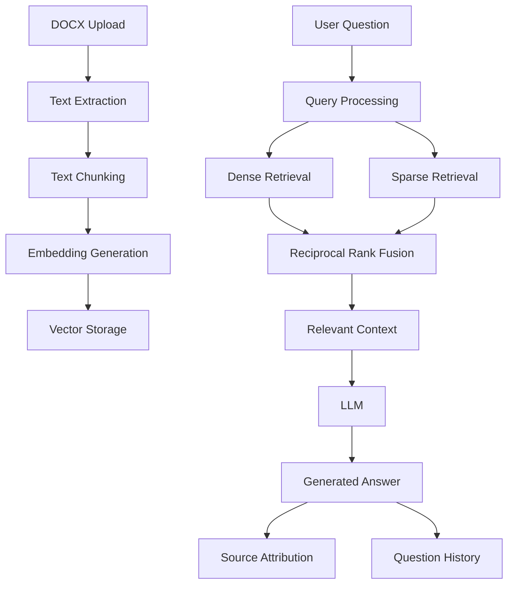

# DocuMind — Document-Based Question Answering System

DocuMind is a document-based Question Answering system built with Django and Retrieval-Augmented Generation (RAG). It allows users to upload and manage DOCX documents, retrieve relevant information from their content, and generate context-aware answers using a Large Language Model (LLM).

The system combines semantic and keyword-based retrieval to improve document search and answer relevance.

## Features

- **Document Management:** Upload, retrieve, update, and delete documents.
- **DOCX Support:** Extract and store the full text of uploaded Word documents.
- **Automatic Indexing:** Split documents into overlapping chunks and generate vector embeddings.
- **Hybrid Retrieval:** Combine dense semantic search and sparse keyword-based search.
- **Reciprocal Rank Fusion (RRF):** Merge retrieval rankings into a unified result list.
- **Context-Aware Answer Generation:** Generate answers based on retrieved document passages.
- **Source Attribution:** Return the document and chunk information used to generate each answer.
- **Question History:** Store questions, generated answers, sources, and timestamps.
- **REST API:** Expose document management and question-answering functionality through Django REST Framework.
- **API Documentation:** Interactive API documentation using Swagger UI.
- **Admin Dashboard:** Manage documents and inspect question history through Django Admin.
- **Docker Support:** Run the application using Docker Compose.

## Architecture

DocuMind follows a Retrieval-Augmented Generation architecture.

### RAG Pipeline



### Document Processing

1. A user uploads a DOCX document through the REST API.
2. The application extracts its textual content.
3. The extracted text is divided into smaller, overlapping chunks.
4. FastEmbed generates vector embeddings for each chunk.
5. The chunks and their embeddings are stored in the database.

### Retrieval and Answer Generation

1. The user submits a question.
2. The system performs dense semantic retrieval and sparse keyword-based retrieval.
3. Reciprocal Rank Fusion (RRF) combines the retrieval rankings.
4. The most relevant passages are selected as context.
5. The retrieved context is passed to the configured LLM through LangChain.
6. The generated answer and its source references are returned and stored in question history.

## Technology Stack

| Component | Technology |
|---|---|
| Backend | Python, Django |
| REST API | Django REST Framework |
| API Documentation | drf-spectacular / Swagger UI |
| RAG Framework | LangChain |
| Embedding Model | FastEmbed |
| LLM Provider | OpenRouter |
| Database | SQLite |
| Document Processing | python-docx |
| Containerization | Docker, Docker Compose |
| Testing | Django Test Framework |

## Project Structure

```text
DocuMind/
├── config/
│   ├── settings.py
│   ├── urls.py
│   └── wsgi.py
│
├── documents/
│   ├── models.py
│   ├── serializers.py
│   ├── services.py
│   ├── views.py
│   ├── urls.py
│   └── admin.py
│
├── qa/
│   ├── models.py
│   ├── serializers.py
│   ├── views.py
│   ├── urls.py
│   └── admin.py
│
├── rag/
│   ├── embeddings.py
│   ├── chain.py
│   ├── llm_client.py
│   └── text.py
│
├── Dockerfile
├── docker-compose.yml
├── requirements.txt
├── .env.example
└── manage.py
```

## Getting Started

### Prerequisites

- Docker
- Docker Compose
- An OpenRouter API key

### 1. Clone the Repository

```bash
git clone https://github.com/Nacmkoohes/DocuMind.git
cd DocuMind
```

### 2. Configure Environment Variables

Create your environment file:

```bash
cp .env.example .env
```

Configure the required environment variables:

```env
SECRET_KEY=your_django_secret_key
DEBUG=False
ALLOWED_HOSTS=localhost,127.0.0.1

OPENROUTER_API_KEY=your_openrouter_api_key
OPENROUTER_MODEL=your_selected_model
OPENROUTER_BASE_URL=https://openrouter.ai/api/v1

LLM_TEMPERATURE=0.2
LLM_MAX_TOKENS=1500
LLM_TIMEOUT=30
```

Use a valid model identifier supported by OpenRouter. Keep your API key and Django secret key private.

### 3. Build and Start the Application

```bash
docker compose up -d --build
```

### 4. Apply Database Migrations

```bash
docker compose exec web python manage.py migrate
```

### 5. Create an Admin Account

```bash
docker compose exec web python manage.py createsuperuser
```

### 6. Access the Application

| Service | URL |
|---|---|
| API | http://localhost:8000/api/ |
| Swagger UI | http://localhost:8000/api/docs/ |
| Django Admin | http://localhost:8000/admin/ |

## API Endpoints

### Document Management

Base endpoint:

```text
/api/documents/
```

| Method | Endpoint | Description |
|---|---|---|
| GET | `/api/documents/` | List documents |
| POST | `/api/documents/` | Upload or create a document |
| GET | `/api/documents/{id}/` | Retrieve document details |
| PUT | `/api/documents/{id}/` | Update a document |
| PATCH | `/api/documents/{id}/` | Partially update a document |
| DELETE | `/api/documents/{id}/` | Delete a document |

DOCX documents can be uploaded using multipart form data.

### Question Answering

**POST** `/api/qa/ask/`

Example request:

```json
{
  "question": "Why is chunking important in document retrieval?",
  "top_k": 5
}
```

Optional document filtering:

```json
{
  "question": "What does the document say about semantic search?",
  "top_k": 5,
  "document_ids": [1, 2]
}
```

Example response:

```json
{
  "answer": "Chunking helps retrieve relevant passages efficiently...",
  "sources": [
    {
      "source_id": 1,
      "document_id": 1,
      "document_title": "Example Document",
      "chunk_id": 3,
      "text": "Relevant document passage..."
    }
  ]
}
```

### Question History

**GET** `/api/qa/history/`

Returns previously submitted questions, generated answers, source references, retrieval settings, and timestamps.

## Testing

Run the Django test suite inside the Docker container:

```bash
docker compose exec web python manage.py test
```

The current test suite contains 8 tests, all of which have passed in the development environment.

## Configuration

Important configuration options include:

| Setting | Description |
|---|---|
| `EMBEDDING_BACKEND` | Selects the embedding implementation |
| `EMBEDDING_MODEL` | Specifies the embedding model |
| `CHUNK_SIZE` | Maximum chunk size |
| `CHUNK_OVERLAP` | Overlap between consecutive chunks |
| `OPENROUTER_MODEL` | Configures the LLM |
| `LLM_TEMPERATURE` | Controls generation randomness |
| `LLM_MAX_TOKENS` | Sets the maximum generated token count |
| `LLM_TIMEOUT` | Sets the LLM request timeout |

## Design Considerations

- **Modularity:** Document processing, embedding generation, retrieval, and LLM interaction are separated into dedicated components.
- **Hybrid Search:** Dense and sparse retrieval complement each other by capturing semantic similarity and keyword relevance.
- **Source Attribution:** Retrieved passages are returned alongside generated answers to improve traceability.
- **Automatic Re-indexing:** Changes to document content trigger re-indexing.
- **Persistent Storage:** Docker volumes are used to preserve application data across container recreation.

## Limitations and Future Improvements

Potential areas for further development include:

- Improving retrieval relevance through evaluation and tuning.
- Adding authentication and user-specific document access.
- Introducing a dedicated vector database for larger collections.
- Adding a frontend interface for document management and question answering.
- Implementing pagination and filtering for question history.
- Adding retrieval evaluation metrics and performance benchmarks.

## License

This project was developed as an educational and engineering project. A license can be added when the distribution terms are defined.
